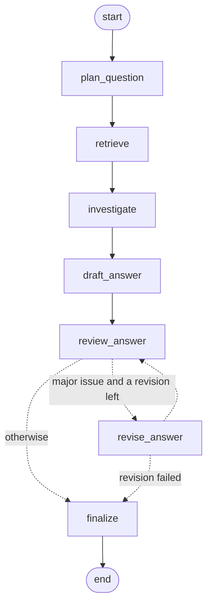

# Pharmacology Research Agent

An agentic research assistant that answers compound pharmacology questions from a fixed corpus of FDA drug labels (DailyMed) and consumer drug monographs (MedlinePlus). It plans the question, retrieves label sections, lets the agent call local tools when evidence is missing, writes an answer where every claim is cited, and has a critic check that answer against its sources before it is shown.

> **Not medical advice.** Answers describe what the provided labels state. They are generated for informational purposes only; a disclaimer is appended to every answer by the code.

---

## Quick start (Docker)

1. Create a `.env` file from the template and fill in your values:

   ```bash
   cp .env.example .env
   ```

2. Build and run, exactly as specified in the assignment:

   ```bash
   docker build -t agent . && docker run -p 8000:8000 --env-file .env agent
   ```

3. Open **http://localhost:8000** for the web interface, or call the API (see below).

### What to expect

- **Startup is near-instant.** Precomputed corpus embeddings ship in the image. If you configure a different embedding model, they are recomputed automatically at startup (about 30 s).
- **An answer typically takes 10 to 30 seconds**: planning, retrieval, optional tool calls, drafting, and a critic review, sometimes followed by one revision and a second review. Under the provider's rate limits an answer can take longer; the client waits and retries instead of failing. The web interface shows each step live.
- **`.env` robustness:** values may be quoted (`OPENAI_MODEL='gpt-...'`), and both `OPENAI_BASE_URL` and `OPENAI_BASE_UR` are accepted. `docker run --env-file` passes quotes literally, so every value is cleaned in one place (`app/config.py`).

### Running without Docker

Requires Python 3.11+ (developed and tested with 3.13).

```bash
python -m venv .venv
# Windows: .\.venv\Scripts\Activate.ps1    macOS/Linux: source .venv/bin/activate
pip install -r requirements-dev.txt
cp .env.example .env            # then fill in your values
python -m uvicorn app.api.main:app --port 8000
```

### Running the tests

```bash
python -m pytest -q
```

134 tests, about 5 seconds. They never call the LLM: they use fake clients and fake vectors, so they are fast, free and reproducible.

---

## Using it

### Web interface (`GET /`)

Ask a question or pick an example. The page shows the agent's steps as they complete, then the answer with clickable citations, the sources (linked to DailyMed or MedlinePlus), the verification status, any points raised by the critic, and a "How this answer was built" panel with the plan, the tools the agent chose, and timings.

### API

| Endpoint | Description |
|---|---|
| `GET /health` | Liveness check, returns `{"status": "ok"}` |
| `POST /ask` | Body `{"question": "..."}`, returns the full answer as JSON |
| `POST /ask/stream` | Same answer as Server-Sent Events: one `step` event per graph node, then a `result` event |
| `GET /docs` | Interactive Swagger documentation |

Example:

```bash
curl -X POST http://localhost:8000/ask \
  -H "Content-Type: application/json" \
  -d '{"question": "What are the main contraindications for warfarin?"}'
```

Main response fields:

| Field | Meaning |
|---|---|
| `answer` | Answer text with citations such as `[S1]` |
| `status` | `verified` if the last review found no major issue, otherwise `unverified` |
| `citations` | The cited sources: id, file, section, URL |
| `not_covered` | What the corpus does not answer (always lists drugs that are not in the corpus) |
| `issues` | Points raised by the deterministic checks and the critic |
| `plan`, `tool_calls`, `trace` | How the answer was produced, with per-step timings |
| `disclaimer` | The medical disclaimer |

Errors: `422` for an empty, missing or too long question; `502` if the language model provider fails; `500` for anything else, without internal details.

---

## How it works



The graph is orchestrated with **LangGraph** (`app/agent/graph.py`). `scripts/draw_graph.py` generates this diagram from the code (`docs/agent_graph.mmd`). Each node is a one-line call to a component that is tested on its own; the graph only owns the control flow.

1. **Plan** (`app/agent/planner.py`). One LLM call with a strict JSON schema decomposes the question into retrieval tasks: a short English search query, a drug, and preferred section types. Drug names are restricted to an enum built from the corpus (brand names such as Coumadin are mapped to generic names). A deterministic guard adds a task for any corpus drug named in the question but missing from the plan. If the call fails, the question itself is searched.
2. **Retrieve** (`app/retrieval/`). In-memory cosine similarity over 462 section-level chunks, as a single NumPy matrix product. The drug filter is **strict**, so one drug cannot crowd out another in a comparison. Section types are a **preference**: each task alternates hits from its preferred sections and from the whole drug. An unfiltered search on the full question acts as a safety net. Results are merged round-robin, so every task's best hit is kept.
3. **Agent tools** (`app/agent/investigator.py`, `app/agent/tools.py`). The model inspects the retrieved passages and decides, through native tool calling, whether to call a tool to fill a specific gap: `search_corpus`, `get_section` or `lookup_glossary`. Nothing in the sequence is hardcoded. The loop is bounded, and every passage a tool returns becomes a citable source.
4. **Draft** (`app/agent/answer.py`). The answer uses only the numbered sources and cites every factual sentence. Code then checks: citations that match no source, an answer with no citation, a cited sentence about an out-of-corpus drug whose sources never name it, and a value from the question restated in a different unit.
5. **Review** (`app/agent/critic.py`). The critic checks each sentence against the cited text and reports issues from a closed list (unsupported, wrong citation, drug transfer, clinically ambiguous, incomplete), each with a severity. Its issues are merged with the deterministic ones.
6. **Revise, then always re-review.** Code decides: any major issue triggers a revision, if one is still allowed (`MAX_REVISIONS`, default 1). Every revision is reviewed again. The status comes from the **last** review; if the critic cannot run or a revision fails, the answer is shown as `unverified`, never silently as verified.

### Assignment requirements, mapped to the code

| Requirement | Where |
|---|---|
| Plan: decompose the question | `app/agent/planner.py` |
| Retrieve with in-memory similarity | `app/retrieval/vector_index.py`, `app/retrieval/tasks.py` |
| At least two local tools, chosen by the agent | `app/agent/tools.py` (3 tools), `app/agent/investigator.py` (native tool calling) |
| Review: flag unsupported or clinically ambiguous claims before the final answer | `app/agent/critic.py`, deterministic checks in `app/agent/answer.py`, loop in `app/agent/graph.py` |
| Cited answer with an explicit disclaimer | `app/agent/answer.py`, `MEDICAL_DISCLAIMER` in `app/agent/prompts.py` |
| Python 3.11+, pinned dependencies | `requirements.txt`, `requirements-dev.txt` |
| `GET /health`, `POST /ask` | `app/api/main.py` |
| Minimal frontend calling the API | `app/web/index.html` |
| Dockerfile, run with `--env-file` | `Dockerfile` |

---

## Key design decisions

- **Inspect the data before designing.** The corpus was examined before any chunking code was written. That revealed the numbered FDA sections, two labels in the pre-2006 format (albuterol, ibuprofen), two short OTC "Drug Facts" labels (acetaminophen, aspirin), and a stray `#` line in the atorvastatin label that a generic splitter would have turned into a fake section.
- **One chunk per section, with a breadcrumb.** Each chunk carries `Drug (Source) > section path`, prepended before embedding, because sections look alike across drugs. Oversized sections are split at paragraph breaks, and tables stay whole.
- **In-memory NumPy instead of a vector database.** 462 vectors (about 2.8 MB) are searched in a fraction of a millisecond. Vectors are normalized once, so cosine similarity is a dot product. A vector database would add infrastructure with no benefit at this scale.
- **Measure before building.** Plain semantic search missed warfarin entirely on the comparison question (all top hits were apixaban, whose label often mentions warfarin). Per-drug filtered queries were tested with existing code before the planner was written.
- **What can be checked by code is checked by code.** Invalid citations, uncited answers, drug transfers and silent unit changes are detected deterministically and force a revision; the LLM critic is used for what needs judgment.
- **Model knowledge may guide the search, never the answer.** The planner and the agent may use general knowledge to choose what to search for; the answer may only state what the sources say.
- **Nothing hardcoded.** Credentials and model names come only from the environment; each tunable value has one documented default in `app/config.py`. Domain facts (for example, "FDA section 4 is contraindications") are named tables in the code.
- **Resilient to the provider.** Precomputed embeddings ship in the image, keyed by model name and chunk content, so a different model or corpus triggers recomputation. The client honours the provider's retry delays on rate limits.

---

## Corpus

`data/corpus/`: 21 Markdown files, about 500 KB.

- For each of 10 drugs (acetaminophen, albuterol, amoxicillin, apixaban, aspirin, atorvastatin, ibuprofen, metformin, sertraline, warfarin): one FDA label from **DailyMed** and one consumer monograph from **MedlinePlus**.
- `GLOSSARY.md`: 25 term definitions. The glossary defines terms; it is never used as evidence about a drug.
- Parsed into **462 chunks**, each typed by section (contraindications, interactions, dosage...) for filtering and citation.

Corpus specifics worth knowing: the DailyMed "albuterol" label is an albuterol and ipratropium inhalation combination, while the MedlinePlus albuterol monograph covers oral albuterol; the acetaminophen and aspirin DailyMed files are short OTC labels without a contraindications section.

---

## Evaluation

### Automated tests

134 tests cover all deterministic logic: parsing and section classification (including the corpus quirks above), retrieval and filters, the task executor (strict drug filter, section preference, round-robin), the planner's safeguards, the tools and the bounded tool loop, the deterministic answer checks, the critic and the revision contract, the graph's control flow, the API, and configuration parsing as delivered by `docker run --env-file`.

### Retrieval measurements (public questions)

| Strategy | Result |
|---|---|
| Plain semantic search, top 5 | 5 of 6 expected files (warfarin missed on the comparison question) |
| Single query vs. planned retrieval, equal chunk budget | 6 of 7 vs. **7 of 7** expected sections |
| Plans written by the LLM planner (two runs) | **7 of 7** expected sections, both runs |

### End-to-end question series

The agent was tested on 29 questions: the 4 public questions plus 25 designed to break it, including three-drug interactions, switching and peri-operative protocols, brand names (Coumadin, Tylenol, Zoloft, Eliquis), misspellings, French questions, units (eGFR vs. creatinine clearance, grams vs. milligrams), false premises, a statin-in-pregnancy question where the model's training knowledge differs from the provided label, out-of-corpus drugs (Ozempic, Xarelto, naproxen), an off-topic question, a vague question and a prompt injection.

- All 29 end with a correct, cited answer; many claims were checked line by line against the source files.
- The 4 public questions cite all 6 expected source files and are all `verified`.
- The series led to **7 general fixes** (not tuned to single questions), for example: summaries must keep the source's recommendation strength; each product or formulation of a drug is presented separately; an out-of-corpus drug never appears in a cited sentence or heading; questions the corpus does not cover get a fixed message with no citations; and the startup no longer fails under the provider's rate limit.

Helper scripts used during evaluation: `scripts/check_llm.py` (provider capabilities), `scripts/inspect_corpus.py`, `scripts/check_retrieval.py`, `scripts/check_planner.py`, and `scripts/ask.py` (the full agent from the command line).

---

## Configuration

| Variable | Default | Purpose |
|---|---|---|
| `OPENAI_API_KEY` | required | API key for the OpenAI-compatible endpoint |
| `OPENAI_BASE_URL` (or `OPENAI_BASE_UR`) | OpenAI default | Endpoint URL, for example the LiteLLM proxy |
| `OPENAI_MODEL` | required | Chat model |
| `OPENAI_EMBEDDING_MODEL` | `text-embedding-3-small` | Embedding model |
| `CORPUS_DIR` | `data/corpus` | Corpus location |
| `GLOSSARY_PATH` | `<CORPUS_DIR>/GLOSSARY.md` | Glossary file |
| `CACHE_DIR` | `.cache` | Embeddings cache |
| `CHUNK_MAX_CHARS` | 3500 | Maximum chunk size before a section is split |
| `EMBEDDING_BATCH_SIZE` | 100 | Texts per embeddings request |
| `RETRIEVAL_TOP_K` | 5 | Results of the unfiltered safety-net search |
| `TASK_TOP_K` | 3 | Results kept per planned task |
| `MAX_CONTEXT_CHUNKS` | 12 | Passages from planned retrieval |
| `MAX_PLAN_TASKS` | 6 | Maximum retrieval tasks per question |
| `MAX_TOOL_ROUNDS` | 3 | Maximum rounds of agent tool calls |
| `TOOL_MAX_RESULTS` | 4 | Passages per `get_section` or glossary call |
| `MAX_TOOL_CHUNKS` | 8 | Passages the tools may add per question |
| `MAX_REVISIONS` | 1 | Revisions after a major issue (0 disables revision) |
| `MAX_QUESTION_CHARS` | 2000 | Longest accepted question |
| `LLM_MAX_RETRIES` | 6 | Retries on provider errors and rate limits |
| `LLM_TIMEOUT_SECONDS` | 60 | Timeout per LLM call |

---

## Project structure

```
app/
  config.py            settings from the environment (the only place that reads it)
  llm.py               shared OpenAI-compatible client
  bootstrap.py         builds the agent once, at startup
  ingestion/           Markdown -> section chunks; glossary parsing
  retrieval/           embeddings and cache, in-memory index, filters, task executor
  agent/               prompts, planner, tools, investigator, answer, critic, LangGraph graph
  api/                 FastAPI app and response schemas
  web/index.html       web interface
data/
  corpus/              the 21 corpus files
  embeddings/          precomputed embeddings shipped in the image
  eval_questions.json  public questions with expected sources and sections
docs/agent_graph.mmd   graph diagram generated from the code
scripts/               evaluation and inspection helpers
tests/                 134 tests
```

---

## Limitations and next steps

**Current limitations**

- **Latency:** 10 to 30 seconds per answer, more under the provider's rate limits; the interface shows progress live.
- **The critic is an LLM judging an LLM.** It can vary between runs and can miss an issue, which is why everything checkable is also checked by code and every claim is cited for the reader to verify.
- **Drug-to-drug transfer inside the corpus** (for example, ibuprofen information applied to aspirin) is checked only by the critic; the deterministic transfer check covers out-of-corpus drugs.
- **Small corpus:** 10 drugs, with no label versions or dates.
- **Single-turn:** each question is answered independently, with no conversation memory.
- **English-only interface text:** answers follow the question's language, but the disclaimer and interface labels are in English.
- **Vague questions** (for example "Is it safe?") receive the "not covered" message rather than a request to specify the drug.

**Possible next steps**

- A broader automated evaluation run over many repetitions to measure variability.
- A faster model or a lower reasoning effort for planning and tool selection, measured against answer quality.
- Hybrid retrieval (BM25 with semantic search) if exact-term misses appear.
- Exposing the three tools through an MCP server for other clients.
- Clarifying questions for vague input, a translated disclaimer, and conversation memory with a question-rewriting step.